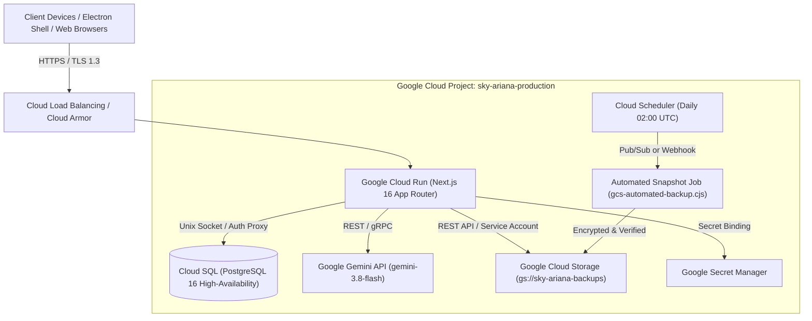

# Sky Ariana BOL — Google Cloud Platform (GCP) Deployment Architecture

This guide provides the complete enterprise deployment architecture for Sky Ariana BOL on **Google Cloud Platform (GCP)** using **Cloud Run**, **Cloud SQL (PostgreSQL)**, **Google Cloud Storage (GCS)**, and the **Google Gemini AI Platform**.

---

## 1. High-Level Architecture Overview



---

## 2. Infrastructure Components

### A. Google Cloud Run (Application Tier)
- **Runtime**: Containerized Next.js 16 App Router with standalone output.
- **Port**: 8080 (Mapped to internal Next.js server).
- **Scaling**:
  - Minimum instances: `1` (prevents cold-starts during business hours in Afghanistan/UAE/India time zones).
  - Maximum instances: `10` (dynamic auto-scaling under peak invoice/report generation loads).
  - Memory: `2 GiB`, CPU: `2 vCPU`.
  - Execution environment: `Second Generation` (faster startup and full Linux compatibility).

### B. Google Cloud SQL for PostgreSQL (Database Tier)
- **Engine**: PostgreSQL 16 Enterprise.
- **High Availability**: Regional replication with automated failover.
- **Storage**: SSD with automatic storage increase enabled.
- **Point-in-Time Recovery (PITR)**: 7-day transaction log retention.
- **Connectivity**: Private Service Access (VPC peering) via Cloud SQL Auth Proxy without public IP exposure.

### C. Google Cloud Storage (GCS Snapshot Backup Tier)
- **Bucket**: `gs://sky-ariana-backups/`
- **Object Versioning**: Enabled (protects against accidental deletion or corruption).
- **Lifecycle Management**:
  - Live snapshots (`snapshots/`): Retained in Standard storage for 30 days.
  - Nearline transition: 30 days.
  - Coldline transition: 90 days.
  - Deletion of non-current versions: 365 days.

### D. Google Gemini API (Logistics & Financial Intelligence Tier)
- **Primary Model**: `gemini-3.8-flash` (auto-upgrades legacy model requests).
- **Endpoint**: `/api/ai/structured-extract`
- **Capabilities**:
  - Multi-modal BOL extraction (shipper, consignee, Afghan border stations, truck/driver particulars, weights).
  - Ledger invariance verification ($\text{Net Balance} = \text{Total Debit} - \text{Total Credit}$).
  - Offline fallback: Built-in deterministic WhatsApp parser (`lib/services/whatsapp-parser.ts`).

---

## 3. Step-by-Step Deployment Guide

### Prerequisites
Install and authenticate the Google Cloud SDK:
```bash
gcloud auth login
gcloud config set project sky-ariana-production
gcloud services enable \
  run.googleapis.com \
  sqladmin.googleapis.com \
  storage.googleapis.com \
  secretmanager.googleapis.com \
  cloudbuild.googleapis.com
```

### Step 1: Create GCS Snapshot Bucket
```bash
# Create bucket in Asia-South (Mumbai) or Middle East (Dammam/Doha) region
gcloud storage buckets create gs://sky-ariana-backups \
  --location=asia-south1 \
  --uniform-bucket-level-access

# Enable object versioning
gcloud storage buckets update gs://sky-ariana-backups --versioning
```

### Step 2: Configure Secrets in Secret Manager
```bash
echo -n "super-secure-production-session-key" | gcloud secrets create SESSION_SECRET --data-file=-
echo -n "your-gemini-api-key" | gcloud secrets create GEMINI_API_KEY --data-file=-
echo -n "postgresql://bol_admin:DB_PASS@/bol_db?host=/cloudsql/sky-ariana-production:asia-south1:sky-ariana-db" | gcloud secrets create DATABASE_URL --data-file=-
```

### Step 3: Build & Deploy Container to Cloud Run
```bash
# Submit build via Cloud Build
gcloud builds submit --tag gcr.io/sky-ariana-production/bol-software:latest

# Deploy to Cloud Run
gcloud run deploy sky-ariana-bol \
  --image gcr.io/sky-ariana-production/bol-software:latest \
  --platform managed \
  --region asia-south1 \
  --allow-unauthenticated \
  --min-instances 1 \
  --max-instances 10 \
  --memory 2Gi \
  --cpu 2 \
  --set-env-vars "NODE_ENV=production,PORT=8080,GCS_BUCKET_NAME=sky-ariana-backups" \
  --set-secrets "SESSION_SECRET=SESSION_SECRET:latest,GEMINI_API_KEY=GEMINI_API_KEY:latest,DATABASE_URL=DATABASE_URL:latest"
```

### Step 4: Automate Daily GCS Snapshot Backups
Run the automated snapshot script locally or via Windows Task Scheduler / Cloud Scheduler:
```bash
# Dry run verification
node scripts/gcs-automated-backup.cjs --dry-run

# Execute live snapshot backup to GCS
node scripts/gcs-automated-backup.cjs
```

---

## 4. Verification & Auditing
- Verify health: `curl -s https://<cloud-run-url>/api/health`
- Run data integrity audit: `node scripts/verify-data-integrity.cjs`
- Run accounting invariance audit: `node tests/ledger-accounting.test.cjs`
